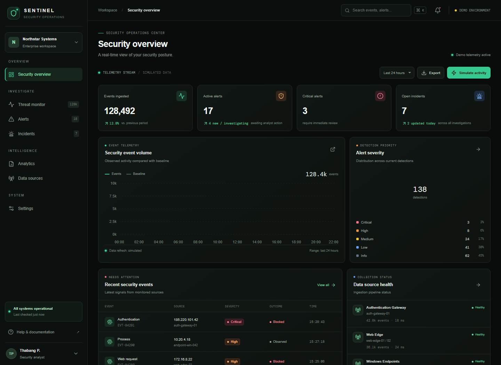
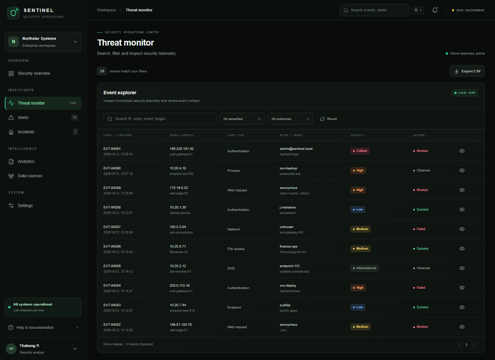

# Sentinel Frontend

Sentinel is a responsive security operations center (SOC) dashboard built with React and TypeScript. It provides a local demonstration of common security workflows: reviewing telemetry, triaging alerts, tracking incidents, and exploring analytics.

The current application runs on typed mock data held in browser memory. It does not connect to or collect data from endpoints, networks, or security products. The Axios client and endpoint helpers are an integration boundary for a future API; the current screens are not yet backed by those endpoints.

## Screenshots

### Security overview

The overview summarizes event volume, detection severity, recent events, and data-source health.



### Threat monitor

The event explorer supports searching, severity and outcome filters, event details, and CSV export.



## Features

- **Security overview**: summary metrics, event-volume and severity charts, recent events, and source health.
- **Threat monitor**: search event fields, filter by severity and outcome, inspect event details, and export the current result set as CSV.
- **Alert triage**: search and filter alerts, inspect detection evidence, and update alert status.
- **Incident response**: filter incidents by workflow status, inspect incident details, and update status.
- **Analytics**: explore illustrative event and detection analytics.
- **Data sources**: review example collector health and onboarding information.
- **Settings**: inspect workspace and integration settings.
- **Simulated activity**: add a synthetic authentication-failure burst and related alert to the current in-memory session.

## Requirements

- Node.js 20.19 or newer, or Node.js 22.12 or newer
- npm (included with Node.js)
- A current desktop or mobile browser

Check installed versions with:

```sh
node --version
npm --version
```

## Getting started

From the project directory, install dependencies and start the Vite development server:

```sh
npm install
npm run dev
```

Open the local URL printed by Vite, usually <http://localhost:5173/>.

To create a local environment file from the example, use the command for your shell. This step is optional for the mock-data demo:

```powershell
# PowerShell
Copy-Item .env.example .env
```

```sh
# macOS, Linux, or Git Bash
cp .env.example .env
```

Restart the development server after changing environment variables. Vite exposes variables prefixed with `VITE_` to browser code; do not put credentials, private keys, or other secrets in them.

## Available commands

| Command | Description |
| --- | --- |
| `npm run dev` | Start the Vite development server with hot module replacement. |
| `npm run build` | Run TypeScript project builds and generate the production bundle in `dist/`. |
| `npm run preview` | Serve the production bundle locally after building. |
| `npm run lint` | Run ESLint across the project. |

For a production build preview:

```sh
npm run build
npm run preview
```

## Application routes

| Route | Screen | Primary workflow |
| --- | --- | --- |
| `/` | Security overview | Review summary metrics, charts, recent events, and source health. |
| `/events` | Threat monitor | Search and filter events, review details, and export filtered events. |
| `/alerts` | Alert triage | Search alerts, inspect evidence, and update triage status. |
| `/incidents` | Incident response | Filter the incident queue and update incident status. |
| `/analytics` | Analytics | Review illustrative activity and detection analytics. |
| `/sources` | Data sources | Review example collection status and source information. |
| `/settings` | Settings | Review workspace and API integration settings. |

## Demo behavior and data

- Events, alerts, incidents, metrics, and source-health values come from `src/lib/mockData.ts`.
- `src/app/SecurityContext.tsx` shares event, alert, and incident state across the application.
- The **Simulate activity** action inserts four synthetic authentication events and a related alert. It does not contact an external system.
- Alert and incident status changes are held in React state. They are not written to a database and reset when the page is reloaded.
- CSV exports are generated in the browser from the current event data or filtered results.
- The data is illustrative and must not be treated as a live detection, response, or monitoring system.

## Configuration and API integration

The example `.env.example` file contains:

| Variable | Purpose |
| --- | --- |
| `VITE_API_BASE_URL` | Base URL configured for the Axios client. Defaults to `http://localhost:8080/api/v1` when unset. |
| `VITE_DEMO_MODE` | Present in the example environment file; the current frontend does not read this flag to switch data sources. |

The client in `src/services/api.ts` defines helpers for these initial API operations:

- `GET /dashboard/summary`
- `GET /events`
- `POST /events/batch`
- `GET /alerts`
- `PATCH /alerts/{id}`
- `GET /incidents`

The application screens currently consume the local mock data and `SecurityContext`; they do not call these API helpers. To connect a backend, align endpoint paths and response DTOs with the server, then replace the relevant mock-data operations with API-backed state and loading/error handling. Frontend environment variables are included in client-side bundles, so never place JWT signing secrets or other private credentials in them.

## Project structure

```text
src/
  app/
    SecurityContext.tsx       Shared in-memory event, alert, and incident state
  components/
    Primitives.tsx            Reusable interface components
    Shell.tsx                 Navigation and shared application layout
  features/
    alerts/                   Alert queue and evidence details
    analytics/                Analytics visualizations
    dashboard/                Security overview
    events/                   Event explorer and event details
    incidents/                Incident queue and workflow
    settings/                 Data-source and workspace settings
  lib/
    mockData.ts               Typed illustrative data and chart series
  services/
    api.ts                    Axios client and initial endpoint helpers
  types/
    security.ts               Shared domain types
docs/
  screenshots/                README screenshots
```

## Technology

- React 19 and TypeScript
- Vite 6 for development and production builds
- React Router for client-side navigation
- Recharts for charts
- Lucide React for icons
- Axios for the prepared API client
- Tailwind CSS and project styles for presentation

## Troubleshooting

- **The page is blank:** check the browser developer console and the Vite terminal for runtime errors. A successful production build cannot detect every error that occurs only when a component renders.
- **The development server uses another port:** Vite selects the next available port and prints the actual URL in its terminal output.
- **Environment changes do not appear:** restart `npm run dev` after editing `.env`.
- **TypeScript or dependency errors:** confirm the Node.js version, then run `npm install` and `npm run build` from the project directory.
- **The API is not reflected in screens:** this release still uses local mock data. Configuring `VITE_API_BASE_URL` does not by itself enable backend-backed screens.

## Responsible use

This project is a frontend demonstration, not a production security product. It does not collect local telemetry or execute containment actions. Only connect future data-source integrations to systems you own or are authorized to monitor, and validate all findings against trusted source logs before taking action.